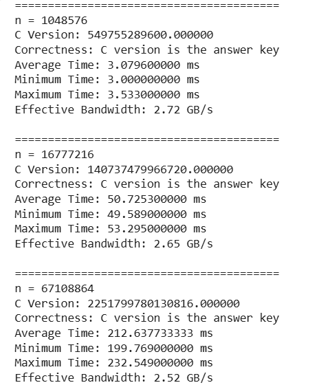

# CEPARCO CUDA Project
### 1st Term AY 2026-2027 | S01 Group 2

---

### Google Colab Link

https://colab.research.google.com/drive/1EojhZSnuqczWude7W41ZF374XOYGh4Xf?usp=sharing

---

## 0. Group Members, Project Specifications, AI Usage Declaration

### Group Members

| Name | GitHub |
| :--- | :--- |
| Dabuit, Daniel Jedrick C. | [@danueli](https://github.com/danueli) |
| Magbatoc, Ethan Daniel | [@ethanndaniel](https://github.com/ethanndaniel) |
| Perez, Jose Bryan | [@JoseBryanPerez](https://github.com/JoseBryanPerez) |
| Uy, Tara Ysabel P. | [@tartar121](https://github.com/tartar121) |

### Project Specifications

The project implements the **Absolute Sum (ASUM)** operation, which calculates the sum of the absolute values of all elements in an input array.

The mathematical definition is:

```
asum = |A[0]| + |A[1]| + ... + |A[n-1]|
```

The project includes the following implementations:

1. C implementation (baseline)
2. x86-64 Assembly implementation
3. SIMD XMM implementation
4. SIMD YMM implementation
5. CUDA V2: Unified Memory without prefetch
6. CUDA V3: Unified Memory with prefetch
7. CUDA V4: Unified Memory with prefetch and explicit page creation
8. CUDA V5: Unified Memory with prefetch, explicit page creation, and memory advice

The CUDA implementations were tested using the following array sizes:

- 2^20 elements
- 2^24 elements
- 2^26 elements

The CUDA implementations were also tested using block sizes of 256, 512, and 1024 threads.

Each CUDA configuration performs 30 timed kernel executions. Correctness is checked against the C implementation.

### AI Usage Declaration

ChatGPT was used to help explain and review the CUDA code and understand CUDA functions. The group ran the programs, collected the benchmark and profiling results, and reviewed the code and report before submission. **add to reflect the whole group

---

## i. Program Output and Correctness Check

The following screenshots show the program outputs and correctness checks for each implementation.

### C Implementation

The C implementation serves as the baseline for checking the correctness of the other implementations.



### CUDA V2: Unified Memory without Prefetch


### CUDA V3: Unified Memory with Prefetch


### CUDA V4: Unified Memory with Prefetch and Explicit Page Creation


### CUDA V5: Unified Memory with Prefetch, Explicit Page Creation, and Memory Advice


All CUDA configurations passed the correctness checks against the C implementation.

---

## ii. Nsight Systems Profiling Results

Nsight Systems was used to examine the execution timeline of the CUDA implementations. It provides information about kernel execution, Unified Memory transfers, CUDA API calls, and synchronization overhead.

### CUDA V2


### CUDA V3


### CUDA V4


### CUDA V5


### Nsight Systems Summary

Across the four CUDA variants, the `asum_kernel` accounts for the largest portion of GPU execution time. Unified Memory transfers also contribute to the overall execution time.

| Variant | Kernel Execution Time | Kernel Percentage | Unified Memory HtoD Time | HtoD Percentage |
|---|---:|---:|---:|---:|
| V2 | 390.048 ms | 91.2% | 36.079 ms | 8.4% |
| V3 | 241.486 ms | 80.6% | 56.309 ms | 18.8% |
| V4 | 239.361 ms | 80.5% | 56.300 ms | 18.9% |
| V5 | 240.870 ms | 80.5% | 56.333 ms | 18.8% |

The profiling results show that the `asum_kernel` accounts for the largest portion of GPU execution time across all four CUDA variants. Unified Memory host-to-device transfers also contribute to GPU execution activity.

V2 relies on automatic Unified Memory management, while V3, V4, and V5 use explicit prefetching to transfer data before kernel execution. This changes the timing and behavior of memory transfers observed by Nsight Systems.

The profiling measurements were collected while Nsight Systems was monitoring the application. Therefore, these measurements are used to examine execution behavior and are not used as the official benchmark timings in the comparative tables.

---

## iii. Comparative Table of Execution Time

### A. C Baseline Results

The following table presents the average execution time of the C implementation for the three tested array sizes.

| Array Size | C Answer Key | Average Execution Time | Minimum Time | Maximum Time |
|---|---:|---:|---:|---:|
| 2^20 | 549755289600 | 3.5865 ms | 3.306 ms | 3.925 ms |
| 2^24 | 140737479966720 | 57.4267 ms | 55.989 ms | 60.720 ms |
| 2^26 | 2251799780130816 | 239.9305 ms | 224.577 ms | 260.875 ms |

### B. CUDA Average Kernel Execution Times

The following tables show the average kernel execution times of each CUDA variant across the three tested array sizes and block sizes.

#### CUDA V2: Unified Memory without Prefetch

| Array Size | Block Size 256 | Block Size 512 | Block Size 1024 |
|---|---:|---:|---:|
| 2^20 | 0.0481 ms | 0.0842 ms | 0.1707 ms |
| 2^24 | 0.5161 ms | 0.5206 ms | 0.5230 ms |
| 2^26 | 2.0549 ms | 2.0367 ms | 2.0394 ms |

#### CUDA V3: Unified Memory with Prefetch

| Array Size | Block Size 256 | Block Size 512 | Block Size 1024 |
|---|---:|---:|---:|
| 2^20 | 0.0548 ms | 0.1017 ms | 0.2059 ms |
| 2^24 | 0.5208 ms | 0.5248 ms | 0.5333 ms |
| 2^26 | 2.0862 ms | 2.0777 ms | 2.0852 ms |

#### CUDA V4: Unified Memory with Prefetch and Explicit Page Creation

| Array Size | Block Size 256 | Block Size 512 | Block Size 1024 |
|---|---:|---:|---:|
| 2^20 | 0.0525 ms | 0.0876 ms | 0.1754 ms |
| 2^24 | 0.5246 ms | 0.5236 ms | 0.5247 ms |
| 2^26 | 2.0995 ms | 2.0624 ms | 2.0519 ms |

#### CUDA V5: Unified Memory with Prefetch, Explicit Page Creation, and Memory Advice

| Array Size | Block Size 256 | Block Size 512 | Block Size 1024 |
|---|---:|---:|---:|
| 2^20 | 0.0550 ms | 0.0971 ms | 0.1973 ms |
| 2^24 | 0.5362 ms | 0.5324 ms | 0.5344 ms |
| 2^26 | 2.0835 ms | 2.0728 ms | 2.0989 ms |

All CUDA configurations passed the correctness check against the C answer key.

### C. CPU Assembly and SIMD Results

The x86-64 Assembly, SIMD XMM, and SIMD YMM implementations were measured in an earlier benchmark using different experimental conditions and array sizes.

The following results are retained from that benchmark.

| Implementation | 2^20 Average (s) | 2^26 Average (s) | 2^27 Average (s) |
|---|---:|---:|---:|
| C | 0.0071 | 0.1268 | 0.5738 |
| x86-64 Assembly | 0.0100 | 0.4323 | 1.7920 |
| SIMD XMM | 0.0014 | 0.0567 | 0.2314 |
| SIMD YMM | 0.0011 | 0.0555 | 0.1700 |

The speedup of each CPU implementation is calculated using the C implementation measured under the same CPU benchmark conditions.

$$
\text{Speedup} =
\frac{\text{C Average Execution Time}}
{\text{Implementation Average Execution Time}}
$$

| Implementation | 2^20 Speedup | 2^26 Speedup | 2^27 Speedup |
|---|---:|---:|---:|
| x86-64 Assembly | 0.71x | 0.29x | 0.32x |
| SIMD XMM | 5.07x | 2.24x | 2.48x |
| SIMD YMM | 6.45x | 2.28x | 3.38x |

A speedup greater than 1 indicates that the implementation is faster than the C baseline. A speedup below 1 indicates that it is slower.

**Note:** These CPU results are presented separately from the current CUDA benchmark because the measurements were taken under different experimental conditions. They should not be interpreted as a direct performance comparison against the CUDA variants.

### D. CUDA Speedup Comparison

For a consistent comparison, the following table uses the C baseline and CUDA results at 2^24 elements.

The selected CUDA configuration uses a block size of 256 threads.

$$
\text{Speedup} =
\frac{\text{C Average Execution Time}}
{\text{CUDA Average Kernel Execution Time}}
$$

| Implementation | Average Execution Time | Speedup vs. C |
|---|---:|---:|
| C Baseline | 57.4267 ms | 1.00x |
| CUDA V2 | 0.5161 ms | 111.27x |
| CUDA V3 | 0.5208 ms | 110.29x |
| CUDA V4 | 0.5246 ms | 109.49x |
| CUDA V5 | 0.5362 ms | 107.14x |

**Note:** These speedup values compare the C execution time against CUDA kernel execution time only. They exclude memory setup operations, prefetching, and other overhead, so they do not represent the speedup of the entire CUDA program.

The results show that CUDA V2 achieved the lowest average kernel execution time among the four CUDA variants at 2^24 elements using a block size of 256. It was followed by CUDA V3, V4, and V5.

CUDA V5 did not achieve better kernel performance than V4 in this configuration, despite the addition of memory advice.

**Note:** V4's block size 512 result was slightly lower at 0.5236 ms. However, this speedup table uses block size 256 for every CUDA variant to maintain a consistent configuration.

### E. CUDA Memory Setup Time

The following tables present the additional memory preparation times for the CUDA variants that use prefetching, explicit page creation, or memory advice.

These operations are performed before kernel execution and are reported separately from the kernel execution times.

#### CUDA V2: Unified Memory without Prefetch

CUDA V2 does not perform explicit memory prefetching or page creation. Therefore, no separate memory setup time is reported for this variant.

#### CUDA V3: Prefetch Setup Time

| Array Size | Prefetch Time |
|---|---:|
| 2^20 | 0.9062 ms |
| 2^24 | 11.4364 ms |
| 2^26 | 46.0979 ms |

#### CUDA V4: Page Creation and Prefetch Setup Time

| Array Size | Page Creation Time | Prefetch Time |
|---|---:|---:|
| 2^20 | 4.4716 ms | 0.9206 ms |
| 2^24 | 61.7331 ms | 11.6792 ms |
| 2^26 | 245.2605 ms | 46.0528 ms |

#### CUDA V5: Page Creation and Advice + Prefetch Setup Time

| Array Size | Page Creation Time | Advice + Prefetch Time |
|---|---:|---:|
| 2^20 | 4.0491 ms | 2.0503 ms |
| 2^24 | 63.4047 ms | 27.9499 ms |
| 2^26 | 275.9889 ms | 93.6388 ms |

The results show that memory preparation introduces additional overhead before kernel execution. This overhead becomes more significant as the array size increases, particularly for the variants that perform explicit page creation. Therefore, kernel execution time alone does not represent the total time required by each CUDA implementation.

---

## iv. Analysis

### A. Analysis of Kernel Execution Time

The CUDA results show that the use of Unified Memory prefetching and explicit page creation can affect kernel execution performance.

CUDA V2 uses Unified Memory without explicit prefetching. In the standalone benchmark results, V2 achieved the lowest average kernel execution time at block size 256 across all three tested array sizes. This shows that the additional memory preparation steps in the other variants did not produce lower kernel execution times in this particular benchmark.

CUDA V3 introduces memory prefetching before kernel execution. This allows the required memory to be transferred to the GPU before the kernel accesses it.

CUDA V4 adds explicit page creation before prefetching. This involves touching memory pages on the CPU before the GPU accesses them. The results show that V4 achieved the lowest average kernel execution time at 2^24 elements with a block size of 512, although its block size 256 result was very close.

CUDA V5 adds `cudaMemAdvise` with `cudaMemAdviseSetReadMostly` before prefetching. This provides the CUDA runtime with information about the expected memory access pattern. However, V5 did not outperform V4 in every configuration.

Although V4 and V5 can reduce kernel execution time, their additional memory setup operations also introduce overhead. In particular, explicit page creation and memory prefetching require additional time before the kernel executes. Therefore, kernel execution time alone does not represent the entire cost of each implementation.

This distinction is important because a CUDA variant with a faster kernel may still require more time to prepare its memory before execution.

### B. Analysis of Speed Performance Across Platforms

The C implementation serves as the baseline for the CUDA speedup calculations.

At 2^24 elements and a block size of 256, all four CUDA variants achieved substantially lower average kernel execution times than the C baseline.

CUDA V2 achieved the highest measured kernel speedup at approximately 111.27x, followed by CUDA V4 at 109.49x, CUDA V5 at 107.14x, and CUDA V3 at 105.14x.

For the CPU implementations, SIMD YMM achieved the highest speedup among the x86-64 Assembly, SIMD XMM, and SIMD YMM implementations in the earlier benchmark.

However, the CPU and CUDA results were obtained under different experimental conditions. Additionally, the CUDA speedup calculations use kernel execution times and exclude memory setup operations. Consequently, these speedup values should not be interpreted as a direct comparison of total execution time between the CPU and GPU implementations.

### C. Effect of CUDA Block Size

The CUDA implementations were tested using block sizes of 256, 512, and 1024 threads.

For 2^20 elements, block size 256 consistently achieved the lowest average kernel execution time across the four CUDA variants.

For 2^24 elements, block size 256 performed best for V2 and V3, while block size 512 achieved slightly lower average times for V4 and V5.

For 2^26 elements, the results were closer across the three block sizes. Some variants performed slightly better with block sizes 512 or 1024.

Based on the measured results, block size 256 generally performed well for smaller and medium-sized arrays. However, the results also show that the best block size can depend on the input size and the GPU's execution characteristics.

This shows that increasing the block size does not automatically result in better performance.

### D. Is Prefetching Always Recommended?

Prefetching is not always necessary or beneficial in every CUDA application.

In this project, prefetching allows Unified Memory data to be transferred to the GPU before kernel execution. This can reduce the delays caused by page faults during GPU execution.

However, prefetching also introduces additional setup time. For larger arrays, the time required to prefetch the data becomes more significant.

Prefetching is useful when the application knows in advance which data will be accessed by the GPU and when that data will be needed.

On the other hand, allowing CUDA to manage memory automatically may be more convenient when memory access patterns are unpredictable or when the overhead of manually managing transfers outweighs the benefits.

Therefore, the decision to use prefetching should depend on the application's memory access pattern and performance requirements.

### E. Nsight Compute Analysis

Nsight Compute was used to examine the individual CUDA kernel's performance characteristics.

Unlike Nsight Systems, which provides an overall execution timeline, Nsight Compute provides more detailed kernel-level metrics.

The following results were collected for the selected `asum_kernel` configuration using a grid size of 1024 blocks and a block size of 256 threads.

| Metric | V2 | V3 | V4 | V5 |
|---|---:|---:|---:|---:|
| Kernel Duration | 559.49 µs | 561.41 µs | 569.63 µs | 571.33 µs |
| DRAM Throughput | 90.28% | 88.04% | 90.23% | 88.64% |
| L1/TEX Cache Throughput | 33.09% | 33.06% | 33.02% | 32.52% |
| L2 Cache Throughput | 28.52% | 28.36% | 27.92% | 27.86% |
| Compute Throughput | 70.78% | 70.77% | 71.32% | 69.93% |
| Registers per Thread | 22 | 22 | 22 | 22 |
| Achieved Occupancy | 98.06% | 98.32% | 98.13% | 98.63% |
| Active Warps per SM | 31.38 | 31.46 | 31.40 | 31.56 |

The results show that all four profiled CUDA variants achieved high occupancy, with achieved occupancy remaining above 98%. This indicates that a high proportion of the GPU's theoretical active warps were available during kernel execution.

DRAM throughput was relatively high across all four variants, ranging from 88.04% to 90.28%. This suggests that memory activity is an important factor in the kernel's performance. Meanwhile, compute throughput ranged from 69.93% to 71.32%.

All four variants also used the same number of registers per thread. This indicates that the changes in memory management did not affect this particular kernel resource metric.

These Nsight Compute measurements are profiling results and are not used as the official benchmark execution times because profiling can introduce measurement overhead.

---

## v. Problems Encountered, Solutions, and AHA Moments

### A. Problems Encountered

**1. Unified Memory Page Faults**

The initial CUDA implementation used Unified Memory without explicit prefetching. This resulted in memory transfers occurring as the GPU accessed data that was not yet available in GPU memory.

**Solution:** CUDA V3 introduced `cudaMemPrefetchAsync` to move the data to the GPU before kernel execution.

**2. Memory Page Initialization**

Although prefetching improved the execution behavior, additional page preparation was explored to control when memory pages were first accessed.

**Solution:** CUDA V4 introduced an explicit page creation step using the system page size obtained through `sysconf(_SC_PAGESIZE)`. A write was performed on each page before initializing the array values.

**3. Memory Access Advice**

The group explored whether providing memory access information to CUDA could further improve performance.

**Solution:** CUDA V5 introduced `cudaMemAdvise` with `cudaMemAdviseSetReadMostly` before prefetching.

**4. GPU Profiling Overhead**

Nsight Systems and Nsight Compute measurements did not always match the standalone benchmark timings.

**Solution:** The group used the standalone, unprofiled execution results for the official performance comparisons and used the profiler results to analyze execution behavior.

**5. GPU Availability**

During the development and testing of the CUDA implementations, GPU access became temporarily unavailable due to Colab usage limits. This prevented the group from running additional tests using the same account.

**Solution:** The group used another available account to continue testing and verify that the CUDA implementations produced the expected results. This allowed the group to proceed with the remaining experiments despite the temporary GPU access limitation.

**6. Additional Memory Setup Overhead**

The group observed that explicit page creation and memory advice introduced additional setup time before kernel execution. Although these operations were intended to improve memory management, they did not always result in a lower overall execution time.

**Solution:** The group recorded page creation and prefetch or advice setup times separately from kernel execution time. This allowed the group to distinguish improvements in kernel performance from the additional overhead introduced by memory preparation.

### B. AHA Moments

One important observation was that improving kernel execution time does not necessarily mean improving the entire program's execution time.

For example, CUDA V4 achieved competitive kernel execution times among the tested CUDA variants. However, its page creation step also introduced additional overhead.

Another observation was that increasing the CUDA block size does not automatically result in better performance. Block size 256 generally performed well for the smaller and medium-sized arrays in this project.

The group also learned that Nsight Systems and Nsight Compute provide different types of performance information. Nsight Systems helps identify where time is spent across the application, while Nsight Compute helps explain how an individual kernel uses GPU resources.

Another important observation was that the fastest kernel does not necessarily mean the fastest overall implementation. V4 and V5 achieved competitive kernel execution times, but their page creation and memory preparation steps introduced considerable additional overhead. This showed the importance of considering both computation time and memory management overhead when evaluating GPU performance.

---

## vi. Differences Between SIMD and SIMT in This Use Case

SIMD and SIMT are approaches used to execute operations across multiple data elements.

SIMD stands for Single Instruction, Multiple Data. It allows a CPU instruction to perform the same operation on multiple data elements simultaneously.

SIMT stands for Single Instruction, Multiple Threads. It allows multiple GPU threads to execute the same instruction on different data elements.

In this ASUM project, both approaches are used to calculate the absolute values of array elements and accumulate their results.

| Aspect | SIMD (CPU) | SIMT (GPU) |
|---|---|---|
| Execution Model | One instruction operates on multiple data elements. | Multiple threads execute the same instruction on different data elements. |
| Hardware | CPU vector registers and execution units. | GPU cores organized into streaming multiprocessors. |
| Implementations | x86-64 Assembly, XMM, and YMM. | CUDA V2, V3, V4, and V5. |
| Parallelism | Data-level parallelism within vector instructions. | Large-scale thread-level parallelism. |
| Data Processing | XMM processes two double-precision values per vector operation, while YMM processes four. | Multiple GPU threads process different array elements in parallel. |
| Advantages | Efficient for vectorizable operations and workloads that fit CPU vector processing. | Can process large amounts of data concurrently through many GPU threads. |
| Disadvantages | Limited by CPU vector width and available CPU execution resources. | May introduce memory transfer, synchronization, and kernel launch overhead. |

### Which Is Faster: SIMD or SIMT?

The performance of SIMD and SIMT depends on the workload, hardware, data size, and memory access pattern.

SIMD is useful for operations that can be performed on multiple data elements using the same instruction. It can be effective for smaller workloads because it does not require launching a separate GPU kernel or managing CPU-to-GPU memory transfers.

SIMT is useful for workloads with large amounts of parallel data processing. GPUs can execute many threads concurrently, making them suitable for large arrays and computational workloads that can be divided into independent operations.

For this ASUM project, both SIMD and SIMT were effective approaches for processing multiple array elements. The CUDA implementations achieved very low kernel execution times compared with the C baseline, while SIMD YMM achieved the highest speedup among the tested CPU implementations in the earlier benchmark.

However, the CPU SIMD and CUDA results were obtained under different experimental conditions. A direct performance comparison would require testing both implementations using the same input data, array sizes, hardware conditions, and timing methodology.

SIMD and SIMT are both useful parallel processing approaches. The more suitable approach depends on the workload, the amount of available parallelism, memory access patterns, and the hardware being used.
